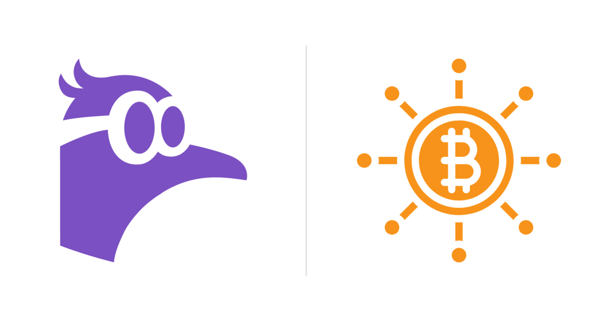

*Featured image: [Nostr](https://github.com/nostr-protocol/nostr) and [Summer of Bitcoin](https://summerofbitcoin.org/) project symbols, composed for this post.*

## Introduction

As my journey in **Summer of Bitcoin 2026** comes to a close, I am excited to share the final evaluation of my project: **Like & Zap Buttons on X.com and YouTube**, contributing to the [Nostr Components](https://github.com/saiy2k/nostr-components) organization under the mentorship of **Sai** ([@saiy2k](https://github.com/saiy2k)).

In my [mid-evaluation blog post](https://summerofbitcoin.github.io/2026/06/28/mid-evaluation-building-like-and-zap-buttons-for-x-and-youtube-with-nostr.html), I documented the transition from early prototypes to real protocol realities. I had built an initial Proof of Concept (PoC) extension injecting Like buttons into X.com and laid the groundwork for an asynchronous backend crawler.

During the second half of the program, the focus shifted from feasibility testing to building an end-to-end, trust-minimized product ecosystem. We expanded the browser extension with full **NIP-57 Lightning zaps** and **YouTube** integration, hardened our **Cloud Run projection pipeline**, and designed, built, and launched **Nostr Atlas** ([nostr-atlas.web.app](https://nostr-atlas.web.app)) — a directory website and self-serve identity verification hub.

Here is the story of what we set out to do, what we engineered, the design decisions made along the way, and what shipped.

---

## What I set out to do

The core mission was to bring sovereign, value-for-value Bitcoin interactions to the platforms where creators and audiences already spend their attention: X.com and YouTube.

On paper, injecting buttons into a webpage sounds like a standard DOM manipulation task. In practice, doing this securely over decentralized protocols reveals two critical architectural challenges:

1. **The Identity Trust Problem:** When a viewer clicks "Zap" on a tweet or YouTube video, which Nostr pubkey and Lightning address should receive the funds? If an extension guesses based on unverified screen names, malicious actors could claim someone else's identity and siphon payments. We needed cryptographic proof linking external accounts to Nostr identities.
2. **The Host Isolation & Protocol Boundary:** Modern Single-Page Applications (SPAs) enforce strict Content Security Policies (CSP) that block external WebSockets and arbitrary network requests. Simultaneously, signing operations must rely on the user's browser signer (via [NIP-07](https://github.com/nostr-protocol/nips/blob/master/07.md)) without exposing keys or compromising user session data.

Our goal was to solve both challenges: building a fast, lightweight browser extension backed by an authoritative, precomputed directory that requires zero paid APIs to verify.

---

## What I built

Over the course of the internship, my contributions spanned three tightly integrated layers:

```
+---------------------------------------------------------------------------------+
|                                 USER INTERFACE                                  |
|                                                                                 |
|   +---------------------------------------+   +-------------------------------+ |
|   |         Chromium Extension            |   |     Nostr Atlas Web App       | |
|   |  - X.com Tweet & Standalone Injection |   |  - Search, Filter, Pagination | |
|   |  - YouTube Watch & Shorts Injection   |   |  - Self-serve Claim Flow      | |
|   |  - CSP-Safe Relay Bridge (NIP-07)     |   |  - (nostr-atlas.web.app)      | |
|   +---------------------------------------+   +-------------------------------+ |
+---------------------------------------^-------------------------------^---------+
                                        |                               |
                               HTTP API | (listAtlasProfiles)           |
+---------------------------------------v-------------------------------v---------+
|                          BACKEND & SERVING LAYER                                |
|                                                                                 |
|   +---------------------------------------------------------------------------+ |
|   |                      Firebase Functions HTTP API                          | |
|   |  - listAtlasProfiles / lookupAtlasHandle                                  | |
|   |  - checkClaimProof / ingestClaim                                          | |
|   +-------------------------------------^-------------------------------------+ |
|                                         |                                       |
|                                         | Reads / Writes                        |
|                                         v                                       |
|   +---------------------------------------------------------------------------+ |
|   |                         Firestore Database                                | |
|   |  (handles, nostrProfiles, claims, relayCrawlerState)                      | |
|   +-------------------------------------^-------------------------------------+ |
+-----------------------------------------|---------------------------------------+
                                          |
                                Writes    | Reads
+-----------------------------------------v---------------------------------------+
|                       CRAWLER & PROJECTION PIPELINE                             |
|                                                                                 |
|   +----------------------------+             +--------------------------------+ |
|   |  Cloud Run Backfill &      |             |     Cloud Run Projection       | |
|   |  Frontfill Jobs            | ----------> |     Pipeline (PR #101)         | |
|   |  - Crawls kind:10011 & 0   | Raw Events  |  - NIP-39 Syndication Checks   | |
|   |  - Resumable Cursors       |             |  - LNURL allowsNostr Check     | |
|   +----------------------------+             |  - Public X Bio Discovery      | |
|                                              +--------------------------------+ |
+---------------------------------------------------------------------------------+
```

### 1. Browser Extension: Like & Zap for X and YouTube ([PR #122](https://github.com/saiy2k/nostr-components/pull/122))
* **X.com Integration:** Injects native-styled Nostr Like and Zap buttons into timeline items, detailed tweet views, and standalone posts.
* **YouTube Integration:** Injects buttons into standard desktop watch pages and YouTube Shorts.
* **CSP-Safe Relay Bridge:** Communicates across the page context boundary so that `window.nostr` can sign events without triggering CSP violations on host sites.
* **Identity Safety Rules:** Ensures that zaps are only rendered when there is an authentic, verified recipient. On YouTube, the recipient must expose a checksum-valid lowercase `npub` in creator-owned channel metadata.

### 2. Cloud Run Projection & Verification Pipeline ([PR #101](https://github.com/saiy2k/nostr-components/pull/101))
* **NIP-39 Ingestion:** Normalizes raw events from relays into indexed Firestore directory documents.
* **Proof Verification:** Verifies proof tweets via unauthenticated Twitter syndication endpoints, ensuring both the screen name and author npub match bidirectionally.
* **Zap Eligibility Checks:** Queries the author's `lud16` Lightning Address endpoint to verify that `allowsNostr: true` is advertised before marking an account as zappable.
* **Bio Discovery:** Parses public profiles for `npub`, `nprofile`, and NIP-05 identifiers without requiring write access to users' profile bios.

### 3. Nostr Atlas Web Directory ([PR #117](https://github.com/saiy2k/nostr-components/pull/117), [PR #133](https://github.com/saiy2k/nostr-components/pull/133), [PR #144](https://github.com/saiy2k/nostr-components/pull/144))
* **Public Directory:** A responsive website live at [nostr-atlas.web.app](https://nostr-atlas.web.app) with category tabs (Creators, Builders, Communities), real-time search across handles and npubs, and server-side cursor pagination.
* **Interactive Claim Flow:** An interactive modal allowing creators to generate a proof tweet, verify it, and submit it directly to the directory via Cloud Functions.

---

## Major technical & design decisions

### 1. A True NIP-57 Zap Flow Instead of Simple Tips
A common pitfall in Lightning integrations is treating a zap as a standard LNURL-pay tip. A real Nostr zap provides verifiable public social proof and increments zap tallies across the network.

We implemented the complete NIP-57 lifecycle:
1. **Fetch LNURL Endpoint:** Resolve the recipient's `lud16` (e.g., `creator@wallet.com` $\to$ `https://wallet.com/.well-known/lnurlp/creator`).
2. **Check Protocol Support:** Validate that the LNURL endpoint returns `allowsNostr: true` and includes a valid `nostrPubkey`.
3. **Sign `kind:9734` Zap Request:** Construct an event specifying the recipient pubkey (`p` tag), amount in millisatoshis (`amount`), and relay list (`relays`), signed via `window.nostr.signEvent`.
4. **Fetch Invoice:** Request the invoice from the LNURL callback URL with the URI-encoded signed zap request.
5. **Prompt Payment:** Dispatch the invoice to the user's WebLN extension (e.g., Alby) or present a QR/fallback.
6. **Receipt Confirmation (`kind:9735`):** Listen on the specified relays for the receipt emitted by the recipient's Lightning provider.

```javascript
// Extract from the extension zap bridge
async function requestZapInvoice(lnurlData, zapRequestEvent, msats) {
  if (!lnurlData.allowsNostr) {
    throw new Error("Recipient wallet does not support Nostr zaps");
  }

  const callbackUrl = new URL(lnurlData.callback);
  callbackUrl.searchParams.set("amount", msats.toString());
  callbackUrl.searchParams.set("nostr", JSON.stringify(zapRequestEvent));

  const response = await fetch(callbackUrl.toString());
  const data = await response.json();
  if (!data.pr) {
    throw new Error(data.reason || "Failed to fetch Lightning invoice");
  }
  return data.pr; // Bolt11 payment request
}
```

### 2. Solving Host Page CSP via an Isolated Extension Bridge
Websites like X.com and YouTube enforce tight Content Security Policies:
* Connecting directly to arbitrary Nostr relays via `new WebSocket(...)` from the page script triggers browser security exceptions.
* Directly calling external Lightning endpoints via `fetch(...)` is blocked by CORS and connect-src directives.

To bypass this without weakening security, we structured the extension into two cooperative halves:
1. **The Page Script:** Runs in the webpage context where it has direct access to `window.nostr` (NIP-07) and the DOM.
2. **The Background Service Worker:** Holds extension-level permissions to open WebSocket connections to rendezvous and write relays, and fetch LNURL payment metadata.

The page script delegates all relay communications and HTTP fetches across a structured `postMessage` / runtime message bridge.

### 3. Strict Two-Tier Trust Model
One of our earliest research findings was that "heuristic" directory matching (e.g., scraping an unverified bio claim) can be easily spoofed. Sending money based on an unverified bio is dangerous.

We instituted a strict two-tier security policy:
* **Tier A (Cryptographically Verified):** Requires a valid NIP-39 proof tweet where the tweet author matches the X handle and the tweet text contains the exact author `npub`. Only Tier A accounts can receive zaps.
* **Claimed / Heuristic Tier:** Accounts detected via bio links or NIP-05 without a full proof tweet. In the UI, the Zap button is disabled and replaced with an **"Invite to Nostr"** action that opens an editable tweet asking the creator to verify their account.

### 4. Bounded Cloud Run Batches vs. 24/7 Firehose
In the initial proposal, we considered running a persistent WebSocket crawler 24/7. In practice, long-lived WebSocket connections to dozens of relays caused connection dropouts, memory leaks, and unnecessary hosting costs.

Because NIP-39 identity events are replaceable (`kind:10011`), they represent a bounded dataset. Working with my mentor Sai, we pivoted to an architecture of **scheduled Cloud Run batch jobs**:
* **Hourly Frontfill (`0 * * * *` UTC):** Scans the newest events with an overlapping time window.
* **Hourly Projection (`30 * * * *` UTC):** Consumes new handle claims, verifies tweets, checks LNURL compatibility, and updates directory records.

This reduced server complexity and kept operational cloud costs essentially at zero.

---

## What shipped

Here is the inventory of pull requests that merged into the core project:

| Pull Request | Description | Status | Evidence |
| :--- | :--- | :--- | :--- |
| **[PR #122](https://github.com/saiy2k/nostr-components/pull/122)** | Add Zap actions and YouTube support to the browser extension | **Merged** | +15,621 / -3,623 lines; 25 extension tests |
| **[PR #144](https://github.com/saiy2k/nostr-components/pull/144)** | Make X account claim dialog functional on Nostr Atlas | **Merged** | +1,050 lines; Cloud Functions integration |
| **[PR #133](https://github.com/saiy2k/nostr-components/pull/133)** | Connect Nostr Atlas to Firestore and add table pagination | **Merged** | +3,847 / -157 lines; [UI Walkthrough Video](https://github.com/user-attachments/assets/a7fb5221-b660-43d4-9aaf-6ed9cd4b2943) |
| **[PR #117](https://github.com/saiy2k/nostr-components/pull/117)** | Add Nostr Atlas standalone directory website | **Merged** | +2,069 lines; responsive search & filtering UI |
| **[PR #101](https://github.com/saiy2k/nostr-components/pull/101)** | Split relay directory projection and X bio discovery | **Merged** | +2,600 lines; Cloud Run worker & verification |
| **[PR #99](https://github.com/saiy2k/nostr-components/pull/99)** | Split relay directory backfill runtime | **Merged** | Resumable cursors & Firestore checkpoints |
| **[PR #87](https://github.com/saiy2k/nostr-components/pull/87)** | Browser extension for injecting Nostr Like buttons on X.com PoC | **Merged** | DOM injection & NIP-07 bridge |
| **[PR #17 (Blog)](https://github.com/SummerOfBitcoin/summerofbitcoin.github.io/pull/17)** | Mid-evaluation blog post on Summer of Bitcoin blog | **Merged** | Published June 28 / July 28, 2026 |

In addition, Nostr Atlas is deployed and active at [nostr-atlas.web.app](https://nostr-atlas.web.app).

---

## What remains

While the agreed core deliverables are merged and functional, a few exploratory ideas remain for future iterations:

1. **Automated YouTube Proof Extraction:** While YouTube Likes work out of the box (as they target the canonical video URL), Zaps currently require the creator to explicitly include their `npub` in their channel description. YouTube does not offer a free, unauthenticated proof endpoint comparable to Twitter oEmbed/syndication. Building an automated, zero-cost proof verifier for YouTube remains an open challenge.
2. **Deep Web-of-Trust Scoring:** We implemented binary trust boundaries (Verified vs. Claimed). Expanding this into a multi-hop Web-of-Trust graph (evaluating NIP-02 follow lists and NIP-85 trusted assertions) would allow dynamic ranking of larger directories.
3. **Chrome Web Store Packaging:** The extension currently runs as an unpacked Chromium extension. Submitting it to the Chrome Web Store with production automated build scripts will make installation seamless for non-technical users.

---

## What I learned

Working on Nostr Components this summer has been an invaluable technical experience. Some of the most important lessons I learned:

* **Protocol Strictness Matters:** Bitcoin and Lightning integrations allow no room for hand-waving. Ensuring that every zap request includes a cryptographic signature and confirming that zap receipts (`kind:9735`) are verified prevents phantom payments and broken user expectations.
* **Design for Host Invasiveness:** Injecting UI into dynamic SPAs like X and YouTube is notoriously difficult. Handling client-side routing changes, lazy-loaded DOM elements, and strict CSP policies taught me how to write robust, non-intrusive frontend code.
* **Separation of Concerns in Distributed Systems:** Decoupling event ingestion, cryptographic projection, and serving into separate Cloud Run jobs was the single best architectural decision of the project. It made debugging straightforward and ensured that relay timeouts never degraded user lookup speeds.

---

## What happens next

My contributions to Nostr Components will continue beyond Summer of Bitcoin:
* Assisting in publishing the extension to the Chrome Web Store.
* Collaborating with the community on additional external identity proofs (e.g., GitHub and Mastodon identity mappings).
* Expanding Nostr Atlas with domain analytics and deeper protocol stats.

---

## Acknowledgments

I want to extend my heartfelt thanks to my mentor **Sai** ([@saiy2k](https://github.com/saiy2k)) for his patient guidance, architectural feedback, and rigorous code reviews throughout the summer. He constantly challenged me to optimize for correctness rather than convenience.

I would also like to thank the **Summer of Bitcoin** team for creating this incredible opportunity to contribute to open-source Bitcoin development, and my fellow contributors in the Nostr ecosystem.

---

## Project links

* **Organization Repository:** [saiy2k/nostr-components](https://github.com/saiy2k/nostr-components)
* **Live Directory:** [nostr-atlas.web.app](https://nostr-atlas.web.app)
* **Mid-evaluation Post:** [Building Like and Zap Buttons for X.com and YouTube with Nostr](https://summerofbitcoin.github.io/2026/06/28/mid-evaluation-building-like-and-zap-buttons-for-x-and-youtube-with-nostr.html)
* **Relevant NIPs:**
  * [NIP-07: `window.nostr` capability for web browsers](https://github.com/nostr-protocol/nips/blob/master/07.md)
  * [NIP-25: Reactions](https://github.com/nostr-protocol/nips/blob/master/25.md)
  * [NIP-39: External Identities](https://github.com/nostr-protocol/nips/blob/master/39.md)
  * [NIP-57: Lightning Zaps](https://github.com/nostr-protocol/nips/blob/master/57.md)

*Disclosure: This post was prepared from my project notes and pull requests with assistance from AI coding tools and verified against the linked repository work.*

